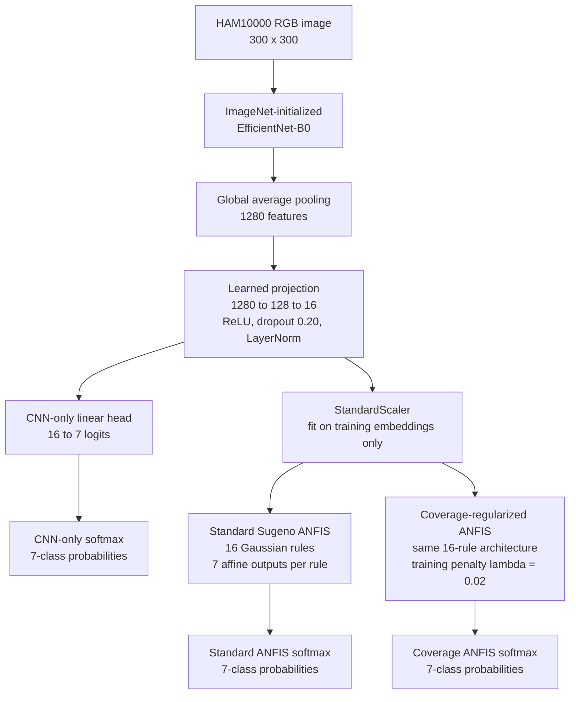

# ACIT4620 — Group 1 Hybrid AI | HAM10000 (Seven Classes)

This repository presents a **single, self-contained Jupyter notebook** for data-centric dermoscopic image classification using EfficientNet-B0 and first-order Takagi–Sugeno adaptive neuro-fuzzy inference (ANFIS).

**Main submission:** [`ACIT4620_Group1_Hybrid_AI.ipynb`](ACIT4620_Group1_Hybrid_AI.ipynb)

> **Research-only prototype.** The seven classes are not all cancers. Results are not a clinical diagnostic validation, and softmax outputs are not clinical risk estimates. Grad-CAM highlights and fuzzy-rule activations provide qualitative diagnostics, not proof of clinical reasoning or causal explanations.

## Compared models

| Model | Architecture |
|---|---|
| CNN-only | ImageNet-initialized EfficientNet-B0 with a neural classifier |
| CNN + standard Sugeno ANFIS | Shared fine-tuned EfficientNet-B0 → learned 16-dimensional representation → 16 Gaussian first-order Sugeno rules → seven class scores |
| CNN + coverage-regularized Sugeno ANFIS | Same CNN–ANFIS structure, with a training penalty encouraging more balanced **mean** fuzzy-rule firing |

The CNN is fine-tuned on HAM10000 images resized to **300 × 300 pixels**. ANFIS training uses gradient-based optimization (AdamW), rather than the classical forward least-squares / backward gradient-descent ANFIS algorithm. The CNN feature extractor is trained first and then used to fit the ANFIS heads; this is a **sequential hybrid**, not a jointly end-to-end trained neuro-fuzzy network.

### Implemented model architecture

The following diagram summarizes the **final Stage B three-model comparison** in the report (Fig. 4). Each prediction branch is evaluated **separately**; these are alternative classifiers, not an ensemble.

The CNN-only classifier is used to train the shared representation first. The two ANFIS heads are then fitted separately on **training-standardized frozen CNN embeddings**. For the coverage head, the extra loss term balances minibatch-average rule firing during training; inference uses the same Sugeno computation as standard ANFIS. Gaussian rule activations are learned from latent features and should not be interpreted as explicit dermatological concepts.

## Dataset and partitioning

- **Dataset:** HAM10000, 10,015 dermoscopic images, seven diagnostic classes: `nv`, `mel`, `bkl`, `bcc`, `akiec`, `vasc`, `df`.
- **Dataset source:** [Skin Cancer MNIST: HAM10000 on Kaggle](https://www.kaggle.com/datasets/kmader/skin-cancer-mnist-ham10000).
- **Generated lesion-disjoint split:** 7,168 training / 1,434 development-validation / 1,413 held-out test images.
- **Split seed:** `20261118`.
- **Split manifest SHA-256:** `14d91a82418a54ee285ce399b3ae45bfadc10a5b54f51eb82df96dbcc5e2cf2d`.
- The partitions are **lesion-ID disjoint**; patient-level disjointness and cross-institution generalization cannot be established from this metadata. The test partition is an internal HAM10000 holdout, **not** the official hidden ISIC Challenge test set.

## What the notebook includes

1. Raw HAM10000 discovery, verification, metadata checks, lesion-disjoint splitting, and exploratory data analysis.
2. Training-only image decode, exposure/contrast and duplicate-candidate audits. Review flags do **not** automatically delete images or replace labels.
3. A sampled heuristic lesion-region audit; the primary model uses **whole images**, not automatically cropped regions.
4. Training-only augmentation, imbalance controls and a **four-epoch screening** of standard training, square-root sampling, weighted loss, and stronger augmentation. This short screen does **not** replace the primary training policy or establish full-training superiority.
5. CNN training with classifier warm-up, deeper fine-tuning, AdamW, learning-rate scheduling, regularization, internal training-only epoch selection and full-training refitting.
6. A training-only **8/12/16-rule** Sugeno screening; the three principal classifiers use the predefined **16-rule** ANFIS configurations.
7. Matched CNN-only, standard ANFIS and coverage-regularized ANFIS validation; **three-fold lesion-grouped training-only cross-validation**.
8. Accuracy, balanced accuracy, per-class and macro precision/recall/F1, AUROC, average precision, melanoma-specific metrics, calibration error, timing and model-size diagnostics.
9. Blue confusion matrices, ROC and precision–recall plots, reliability diagrams, training and optimizer curves, CV variability plots, fuzzy-rule heatmaps and qualitative CNN/hybrid Grad-CAM.
10. A **one-time**, predeclared, three-model comparison on the internal held-out test partition; staged reports and checkpoint ZIP exports.

The main experiment uses internal epoch selection; CV uses a fixed training budget of **16 CNN epochs and 15 ANFIS epochs per fold**. These different training protocols must be considered when interpreting results.

## Results from the completed November 18, 2026 run

**Held-out test (1,413 images; one-time evaluation of all three predeclared models):**

| Metric | CNN-only | CNN + standard ANFIS | CNN + coverage ANFIS |
|---|---:|---:|---:|
| Accuracy | **0.8408** | 0.8351 | 0.8365 |
| Macro-F1 | 0.7080 | 0.7078 | **0.7103** |
| Balanced accuracy | 0.7070 | **0.7370** | 0.7285 |
| Melanoma recall | 0.4000 | **0.4533** | 0.4200 |
| Macro AUROC (one-vs-rest) | **0.9610** | 0.9157 | 0.9163 |
| ECE (15 bins) | 0.0747 | 0.0490 | **0.0342** |

**Three-fold lesion-grouped cross-validation (mean ± sample SD):**

| Metric | CNN-only | Standard ANFIS | Coverage ANFIS |
|---|---:|---:|---:|
| Macro-F1 | 0.6265 ± 0.0329 | 0.6396 ± 0.0232 | **0.6462 ± 0.0239** |
| Balanced accuracy | 0.6167 | 0.6427 | **0.6429** |
| Melanoma recall | 0.4184 | **0.4495** | 0.4431 |

The coverage hybrid achieved a **small** held-out-test macro-F1 improvement over CNN-only (approximately 0.0023). Standard ANFIS improved melanoma recall and balanced accuracy at the selected decision rule, but CNN-only retained substantially higher AUROC. Three folds and a single internal test partition do not demonstrate statistical or clinical superiority. Calibration was evaluated; no independent clinical calibration claim is made.

## Reproduce the experiment

1. Open [`ACIT4620_Group1_Hybrid_AI.ipynb`](ACIT4620_Group1_Hybrid_AI.ipynb) in **Kaggle**.
2. Attach **only the original HAM10000 Kaggle dataset**. No previous results, checkpoints or split manifests are inputs.
3. Select a **GPU** accelerator and ensure official ImageNet EfficientNet-B0 pretrained weights are accessible (internet or an explicitly configured local weights file).
4. Execute the notebook in order / **Run All** for a **new experiment**. The notebook includes substantial training and three CV folds, so adequate compute quota is needed.
5. Save the newly generated outputs and staged ZIP files from `/kaggle/working` **before the session expires**.

The submitted notebook contains a source-code pipeline and an **assembled, explicitly labeled record of outputs from the completed run**, rather than an unmodified Kaggle kernel execution transcript. Its embedded numerical tables and figures are evidence from that run; a fresh execution may differ because training includes stochastic operations. The pretrained ImageNet weights and external HAM10000 dataset are not bundled in the repository.

**For inspection without rerunning:** open the notebook and scroll to its embedded results. **Do not rerun the completed held-out test just to improve or choose scores.** If reproducing from scratch, treat its one-time test evaluation as a new experiment, and do not use the test results for tuning.

## Repository scope

This repository contains **one executable research notebook**, the main README, lightweight dependency/configuration files, and a curated [`results/`](results/) directory. The [`results/README.md`](results/README.md) explains the saved figures, summary tables, and run-provenance metadata. Selected figures and CSV tables **are committed** to support inspection of the report; raw dermoscopic images, model checkpoints, large intermediate archives, and exhaustive prediction exports are not included.

The notebook includes assertions and internal verification checks, but these are not a substitute for full automated integration testing or independent replication. **Do not mix** exploratory results from earlier experimental stages with the final Stage B evaluation because the splits, representations, and training budgets differ. An archive branch, if available in the hosted GitHub repository, is separate from the reproducible final notebook described here.

Useful supporting evidence: [final three-model test metrics](results/tables/one_time_three_model_test_comparison.csv), [grouped-CV summary](results/tables/cv_mean_std_readable.csv), [test confusion matrix for the CNN](results/figures/model_comparison/CNN_300_deeper_test_confusion_matrices.png), [test confusion matrix for coverage ANFIS](results/figures/model_comparison/Sugeno_ANFIS_coverage_test_confusion_matrices.png), and [training-only grouped-CV figure](results/figures/cross_validation/cv_mean_sd_model_comparison.png).

**Dataset citation:** Tschandl, P., Rosendahl, C., & Kittler, H. (2018). The HAM10000 dataset, a large collection of multi-source dermatoscopic images of common pigmented skin lesions. *Scientific Data, 5*, 180161. https://doi.org/10.1038/sdata.2018.161
