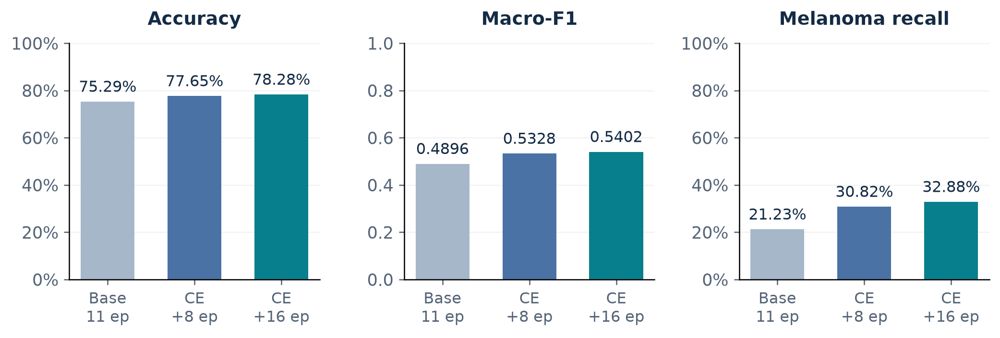
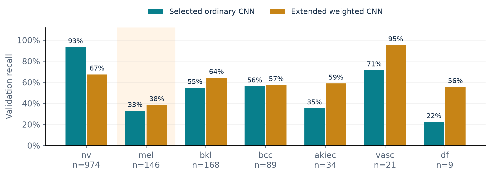

# HAM10000 CNN Results - Team Brief

Prepared: 9 November 2026. Experiments: 7 November 2026.

**Current baseline:** extended ordinary EfficientNet-B0, selected by validation Macro-F1.
These are single-seed validation results, not held-out test results. No neuro-fuzzy result exists yet.

## Setup

- HAM10000: 10,015 images; seven diagnosis categories.
- Fixed lesion-disjoint split: 7,116 train / 1,441 validation / 1,458 test.
- Validation: 1,067 lesions. Patient-level disjointness cannot be verified.
- ImageNet-pretrained EfficientNet-B0; train-only augmentations; batch size 32; seed 42.
- Local NVIDIA RTX 5070 Ti. Fine-tuning updates the last two feature modules and classifier.
- Extensions load saved model weights with fresh optimizer/RNG states.

## Selected-checkpoint results

| Run | Epochs executed in this run | Accuracy | Balanced accuracy | Macro-F1 | Melanoma recall |
|---|---:|---:|---:|---:|---:|
| CE baseline | 11 | 75.29% | 46.69% | 0.4896 | 21.23% |
| CE continuation 1 | 8 | 77.65% | 51.35% | 0.5328 | 30.82% |
| CE continuation 2 | 16 | 78.28% | 52.30% | 0.5402 | 32.88% |
| Weighted CE initial | 7 | 53.57% | 54.82% | 0.3778 | 34.25% |
| Weighted CE extended | 16 | 63.64% | 62.43% | 0.4412 | 38.36% |

## Findings

- Ordinary baseline to current: Macro-F1 0.4896 to 0.5402 (+0.0506), accuracy +2.98 percentage points, melanoma recall +11.64 percentage points.
- The latest ordinary extension adds only +0.0074 Macro-F1; paired lesion-bootstrap 95% interval [-0.0144, +0.0281] includes zero. It corrected 29 errors and introduced 20. This is a modest observed validation gain, not clear evidence of generalization improvement.
- The unweighted lineage executed 35 epochs (11 + 8 + 16); its selected checkpoint is lineage epoch 29, local extension epoch 10.
- The weighted extension improved over its own source from Macro-F1 0.3778 to 0.4412 (+0.0634; paired 95% interval [0.0312, 0.0997]). It selected local epoch 13 after executing 16 epochs, starting from the original weighted head epoch 3.
- The weighted extension reaches balanced accuracy 62.43% and melanoma recall 38.36%, but is below the extended ordinary model on Macro-F1 (0.4412 vs 0.5402). Retain the ordinary CNN as the primary comparison baseline.
- Branches have different starting checkpoints and training histories, so their difference is not an isolated causal estimate of class weighting.

## Remaining weakness and limitations

The selected ordinary CNN identifies 48/146 validation melanoma images and misses 98; melanoma precision is 48.48%. Class supports are uneven; df has only nine validation cases. One seed was used and validation was reused for model selection. Bootstrap intervals are conditional on the fitted models and validation cases; they do not include training-seed variability or remove selection optimism. The final test set was not evaluated.

## Next steps

1. Freeze the selected ordinary CNN checkpoint.
2. Implement and train the neuro-fuzzy corrector using training data only.
3. Compare final seven-class predictions from the same CNN with/without correction.
4. Repeat seeds; freeze the full setup before final held-out testing.

## Evidence and reuse

Exact values and provenance are in `cnn_results_team_brief_20261109_assets/verified_run_metrics.csv`, `selected_class_metrics.csv` and `source_manifest.json`. PNG and editable SVG figures are included. All metrics were checked against saved per-image predictions; no new model training was performed for this report. Class codes follow the fixed order nv, mel, bkl, bcc, akiec, vasc, df.
